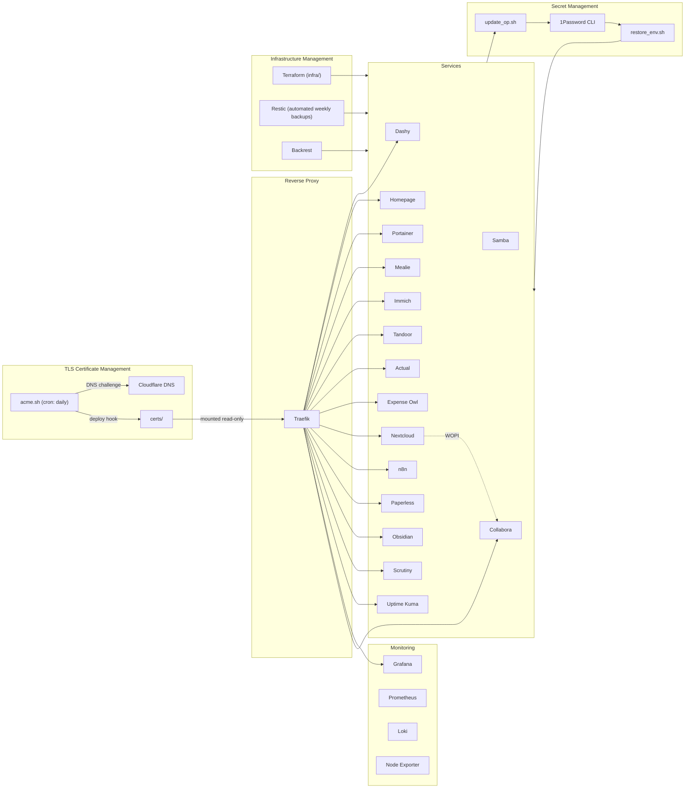

# Chris's Homelab

This is a set of services that are deployed within my tailnet. The basic architecture is as follows:

## Setup (after a fresh clone)

Install dependencies and pre-download the gitleaks binary used by the pre-commit hook:

```bash
pixi run setup
```

Then install the git hook (this doesn't transfer with a clone, so it must be done once manually):

```bash
cat > .git/hooks/pre-commit << 'EOF'
#!/usr/bin/env bash
~/.pixi/bin/pixi run pre-commit run --hook-stage commit
EOF
chmod +x .git/hooks/pre-commit
```

The hook runs [gitleaks](https://github.com/gitleaks/gitleaks) on every `git commit` to catch accidentally staged secrets before they land in history.



### Nextcloud Office (Collabora)

The "Nextcloud Office" app (`richdocuments`) is just a client — it needs a WOPI
backend to actually render and edit documents. `services/collabora.yml`
deploys [Collabora Online](https://www.collaboraoffice.com/code/) for this,
routed through Traefik at `collabora.${DOMAIN}` the same way as every other
service. In Nextcloud, point Settings → Nextcloud Office at
`https://collabora.${DOMAIN}`.

Since `${DOMAIN}` resolves over the tailnet, Nextcloud's server-side WOPI
calls to `collabora.${DOMAIN}` would otherwise leave the container trying to
route to a Tailscale IP it can't reach, timing out. The `traefik` service is
given a Docker network alias for `collabora.${DOMAIN}` on the `belvale`
network (see `compose.yml`), so containers resolve that hostname straight to
the Traefik container instead — still hitting the same TLS termination and
host-based routing, just without leaving the Docker network.

### Storage & file sharing

Disks on the host:

| Mount | Device | FS | Use |
|---|---|---|---|
| `/media/med_2tb` | WD 2 TB | ntfs-3g | Live service data (bind-mounted into containers) |
| `/srv/store` | WD 8 TB | ext4 | `timemachine/` (Time Machine target) + `restic/` (local Backrest/restic repo for `/media/med_2tb`, daily, no password) |

Both are `systemd` mount units (`media-med_2tb.mount`, `srv-store.mount`), pinned
by UUID, `nofail`.

**Samba** runs natively on the host (`smbd`/`nmbd` + `avahi-daemon`), not in the
compose stack — it needs host SMB/mDNS ports and Traefik has nothing to route.
`/etc/samba/smb.conf` is stock Ubuntu plus the `[belvale_2tb]` share
(`/media/med_2tb`, guest, rw). The **Time Machine** additions are tracked in
`conf/samba/` — see `conf/samba/README.md` for the deploy steps.

### Infrastructure Management

The infrastructure, mostly for backup, is managed by Terraform. The main file is `main.tf`, which contains the configuration for the services. The `terraform.tfvars` file contains the variables used in the configuration.

To install terraform, follow the instructions [here](https://developer.hashicorp.com/terraform/downloads) or briefly:

```bash
sudo apt-get update && sudo apt-get install -y gnupg software-properties-common curl
curl -fsSL https://apt.releases.hashicorp.com/gpg | sudo gpg --dearmor -o /usr/share/keyrings/hashicorp-archive-keyring.gpg
echo "deb [signed-by=/usr/share/keyrings/hashicorp-archive-keyring.gpg] https://apt.releases.hashicorp.com $(lsb_release -cs) main" \
  | sudo tee /etc/apt/sources.list.d/hashicorp.list
sudo apt update
sudo apt install terraform
```

This requires that you download GSutil and authenticate with your Google account. Follow the instructions [here](https://cloud.google.com/storage/docs/gsutil_install) or briefly:

```bash
sudo apt-get install apt-transport-https ca-certificates gnupg curl
curl https://packages.cloud.google.com/apt/doc/apt-key.gpg | sudo gpg --dearmor -o /usr/share/keyrings/cloud.google.gpg
echo "deb [signed-by=/usr/share/keyrings/cloud.google.gpg] https://packages.cloud.google.com/apt cloud-sdk main" | sudo tee -a /etc/apt/sources.list.d/google-cloud-sdk.list
sudo apt-get update && sudo apt-get install google-cloud-cli
```

Then authenticate with your Google account:

```bash
gcloud auth login
gcloud auth application-default login
# gcloud auth configure-docker <-- This is not needed for this project but is generally useful if using artifact repo for image storage
```

### Secret management

Secrets are managed by 1Password, specifically through the CLI. This relies on having the OP CLI available and authenticated. To do so, follow the [guide here](https://developer.1password.com/docs/cli/get-started) or briefly:

```bash
curl -sS https://downloads.1password.com/linux/keys/1password.asc | \
  sudo gpg --dearmor --output /usr/share/keyrings/1password-archive-keyring.gpg && \
  echo "deb [arch=$(dpkg --print-architecture) signed-by=/usr/share/keyrings/1password-archive-keyring.gpg] https://downloads.1password.com/linux/debian/$(dpkg --print-architecture) stable main" | \
  sudo tee /etc/apt/sources.list.d/1password.list && \
  sudo mkdir -p /etc/debsig/policies/AC2D62742012EA22/ && \
  curl -sS https://downloads.1password.com/linux/debian/debsig/1password.pol | \
  sudo tee /etc/debsig/policies/AC2D62742012EA22/1password.pol && \
  sudo mkdir -p /usr/share/debsig/keyrings/AC2D62742012EA22 && \
  curl -sS https://downloads.1password.com/linux/keys/1password.asc | \
  sudo gpg --dearmor --output /usr/share/debsig/keyrings/AC2D62742012EA22/debsig.gpg && \
  sudo apt update && sudo apt install 1password-cli
```

Then login using the secret key available on the 1password CLI (under "my account").

```bash
op account add my.1password.com ${EMAIL} ${SECRET_KEY}
```

#### Restoring a `.env` file

Run the `scripts/restore_env.sh` to generate a new `.env` file with accurate secrets. This script gets the most up to date version of the fields previously used.

#### Backing up a `.env` file

Run the script `scripts/update_op.sh` to back-up the `.env` to OP. This basically just splits the fields and adds them to a secure note. It doesn't retain comments.

A caveat of this approach is that the names of variables defined in `.env` have to be unique with respect to the containers that are running. So if two containers need the same env var, some work arounds might be needed.

#### Restic service-account key

The `restic` GCS service account (created by Terraform in `infra/`) needs a JSON
key so the `backrest` container can authenticate. That key is **not** managed by
Terraform — a long-lived credential does not belong in Terraform state — and it
is **not** part of `.env` either. It lives in 1Password as item `backrest-sa-key`
in the `homelab` vault, and `services/backrest.yml` mounts it via
`${HOME}/.config/gcloud` → `/gcloud` with
`GOOGLE_APPLICATION_CREDENTIALS=/gcloud/backrest-sa.json`.

- **Restore it** (fresh machine, before `docker compose up -d backrest`):
  `scripts/restore_sa_key.sh`
- **Back it up / rotate it** (after creating a new key with
  `gcloud iam service-accounts keys create`): `scripts/push_sa_key.sh`