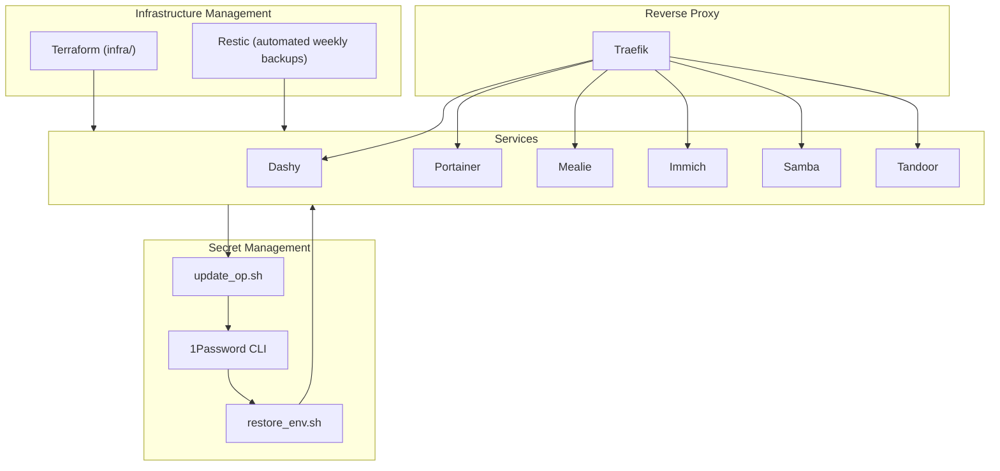

# Chris's Homelab

This is a set of services that are deployed within my tailnet. The basic architecture is as follows:



### Infrastructure Management

The infrastructure, mostly for backup, is managed by Terraform. The main file is `main.tf`, which contains the configuration for the services. The `terraform.tfvars` file contains the variables used in the configuration.

To install terraform, follow the instructions [here](https://developer.hashicorp.com/terraform/downloads) or briefly:

```bash
sudo apt-get update && sudo apt-get install -y gnupg software-properties-common curl
curl -fsSL https://apt.releases.hashicorp.com/gpg | sudo gpg --dearmor -o /usr/share/keyrings/hashicorp-archive-keyring.gpg
echo "deb [signed-by=/usr/share/keyrings/hashicorp-archive-keyring.gpg] https://apt.releases.hashicorp.com $(lsb_release -cs) main" \
  | sudo tee /etc/apt/sources.list.d/hashicorp.list
sudo apt update
sudo apt install terraform
```

This requires that you download GSutil and authenticate with your Google account. Follow the instructions [here](https://cloud.google.com/storage/docs/gsutil_install) or briefly:

```bash
sudo apt-get install apt-transport-https ca-certificates gnupg curl
curl https://packages.cloud.google.com/apt/doc/apt-key.gpg | sudo gpg --dearmor -o /usr/share/keyrings/cloud.google.gpg
echo "deb [signed-by=/usr/share/keyrings/cloud.google.gpg] https://packages.cloud.google.com/apt cloud-sdk main" | sudo tee -a /etc/apt/sources.list.d/google-cloud-sdk.list
sudo apt-get update && sudo apt-get install google-cloud-cli
```

Then authenticate with your Google account:

```bash
gcloud auth login
gcloud auth application-default login
# gcloud auth configure-docker <-- This is not needed for this project but is generally useful if using artifact repo for image storage
```

### Secret management

Secrets are managed by 1Password, specifically through the CLI. This relies on having the OP CLI available and authenticated. To do so, follow the [guide here](https://developer.1password.com/docs/cli/get-started) or briefly:

```bash
curl -sS https://downloads.1password.com/linux/keys/1password.asc | \
  sudo gpg --dearmor --output /usr/share/keyrings/1password-archive-keyring.gpg && \
  echo "deb [arch=$(dpkg --print-architecture) signed-by=/usr/share/keyrings/1password-archive-keyring.gpg] https://downloads.1password.com/linux/debian/$(dpkg --print-architecture) stable main" | \
  sudo tee /etc/apt/sources.list.d/1password.list && \
  sudo mkdir -p /etc/debsig/policies/AC2D62742012EA22/ && \
  curl -sS https://downloads.1password.com/linux/debian/debsig/1password.pol | \
  sudo tee /etc/debsig/policies/AC2D62742012EA22/1password.pol && \
  sudo mkdir -p /usr/share/debsig/keyrings/AC2D62742012EA22 && \
  curl -sS https://downloads.1password.com/linux/keys/1password.asc | \
  sudo gpg --dearmor --output /usr/share/debsig/keyrings/AC2D62742012EA22/debsig.gpg && \
  sudo apt update && sudo apt install 1password-cli
```

Then login using the secret key available on the 1password CLI (under "my account").

```bash
op account add my.1password.com ${EMAIL} ${SECRET_KEY}
```

#### Restoring a `.env` file

Run the `scripts/restore_env.sh` to generate a new `.env` file with accurate secrets. This script gets the most up to date version of the fields previously used.

#### Backing up a `.env` file

Run the script `scripts/update_op.sh` to back-up the `.env` to OP. This basically just splits the fields and adds them to a secure note. It doesn't retain comments.

A caveat of this approach is that the names of variables defined in `.env` have to be unique with respect to the containers that are running. So if two containers need the same env var, some work arounds might be needed.